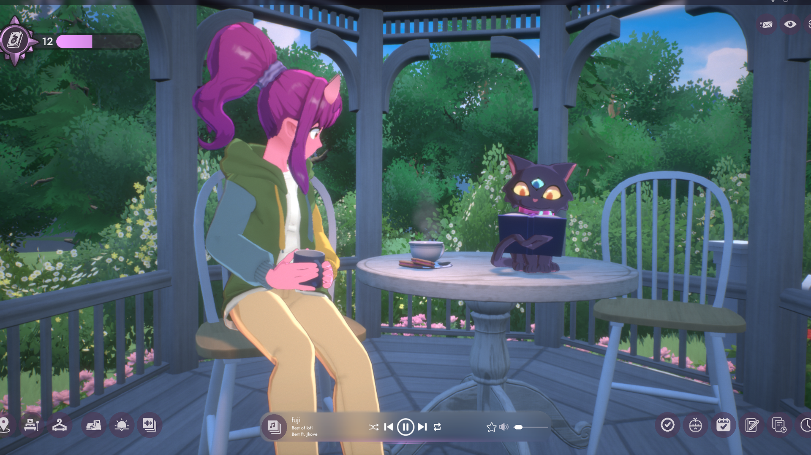
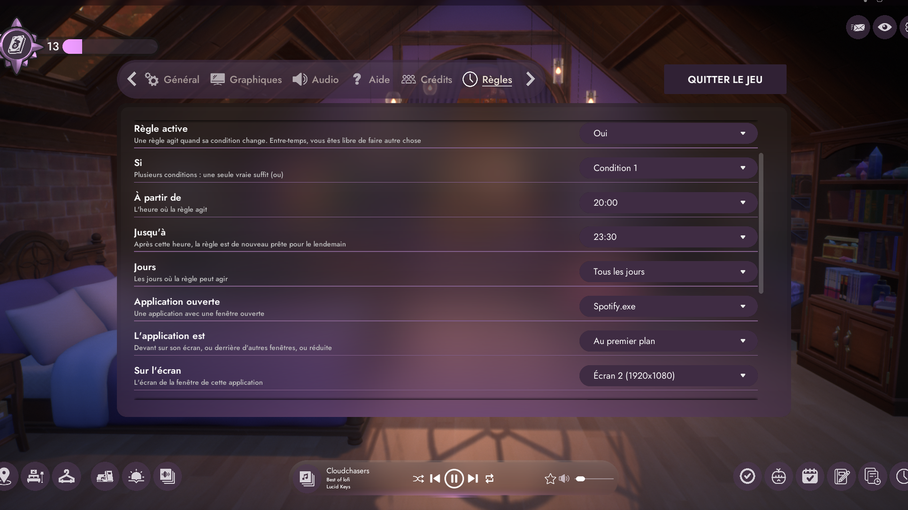
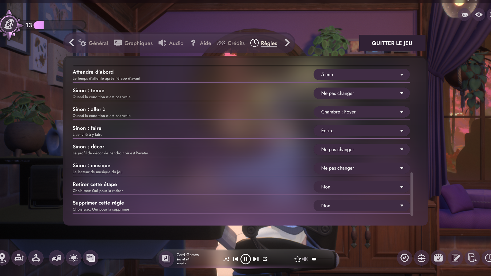

# Avatar Rules

A mod for Spirit City: Lofi Sessions: rules for your avatar, in a new tab of the game's options. Un mod pour Spirit City: Lofi Sessions : des règles pour votre avatar, dans un nouvel onglet des options du jeu.

**[Download / Télécharger](https://github.com/Demonwal51/AvatarRules/releases/latest)**

Rules for your avatar: "if this is true, the avatar does that". You set them in a new tab of the game's options, Options, Rules. It uses the game's own tab, rows and dropdowns, and follows your UI theme.

If: one or several conditions. One true condition is enough. Inside a condition, everything you set must be true:

- A time of day, in steps of 15 minutes, or all day
- Days: every day, Monday to Friday, the weekend, or one day
- A time of year: a season or a month
- The game's Pomodoro: working, on a break or stopped
- The game's music player: playing or paused
- An application: open, in front on its screen, or in the background, on any screen or on one screen

Then: one or several steps, done in order, with a wait of up to two hours between them:

- Wear one of your outfit presets
- Go to a place and do an activity, on any map you own
- Use one of your decor presets
- Music: play, pause or next track

"Try this rule" does it right now, without waiting for the conditions.

To keep the menu short, the time of year, the Pomodoro, the music and the decor are behind one line, Advanced functions, along with:

- Invert the condition: "if it is not true"
- Else: other steps, for when the condition is not true
- When the rule ends: do nothing, or put things back as they were

The menu follows the game's language: English, French, Italian, German, Spanish, Portuguese, Japanese, Simplified Chinese, Korean and Russian. The translations were written by an AI, so corrections are welcome.

## Install

1. Unzip the archive anywhere.
2. Double-click Install.bat. It finds the game by itself. If the game is open, it asks you to close it and carries on once it is closed.
3. Start the game: Options, Rules, then pick New rule in the first list.

To remove it: double-click Uninstall.bat.
UE4SS is included. If you already use UE4SS, yours is kept.

## What the .bat files do

Install.bat and Uninstall.bat first check that the archive is unzipped. Then each one starts a single PowerShell script, `files\setup.ps1`, and allows scripts for that run only (-ExecutionPolicy Bypass). You can open all three with Notepad and read them before running anything.

Install.bat:
- Finds the game: it reads the Steam location from the registry, then your Steam libraries. If it does not find the game, it asks you for the folder.
- Refuses and changes nothing if the folder is not the game's.
- If the game is open, it waits until you close it.
- If UE4SS is not installed, it copies dwmapi.dll and the ue4ss folder into `SpiritCity\Binaries\Win64`, in the game folder, with a small text file that records that a mod brought UE4SS. Its name is RealScreen-installed-UE4SS.txt because the Real Screen mod reads the same file: that way, whichever of the two is removed last takes UE4SS away.
- If UE4SS is already installed, it keeps it as it is and copies only the mod's folder.
- Keeps your rules if you install again.

Uninstall.bat:
- Finds the game the same way, and waits until you close it if it is open.
- Removes the mod's folder, your rules with it.
- In UE4SS's mods.txt, removes the lines of mods whose folder no longer exists. Nothing else in that file is touched.
- Removes UE4SS, dwmapi.dll and the empty LogicMods folder too if a mod brought UE4SS and no other UE4SS mod is there. Otherwise it leaves UE4SS in place.

Neither of them downloads anything, asks for administrator rights, writes to the registry, adds anything to Windows startup or changes your antivirus settings. They do not touch the game's own files or your saves. The logs that UE4SS and the mod create while running are removed with their folders.

Prefer not to run them? Copy the content of `files\game` into the game folder yourself. To remove it, delete the AvatarRules folder from `SpiritCity\Binaries\Win64\ue4ss\Mods`, and if no other UE4SS mod is left, dwmapi.dll and the ue4ss folder from `SpiritCity\Binaries\Win64`.

## Good to know

- A rule acts when its condition changes, and also once when the game starts. It does not come back if you then do something else: it never fights you.
- A rule waits while the options or an editor are open. A rule you have just edited is looked at as soon as you close the options.
- "Put things back" only restores what the rule set and you have not changed since.
- If several rules change at once, what starts goes before what ends, then the higher rule in the list wins. The outfit and the place are decided separately, so one rule can give the place and another one the outfit.
- If rules keep undoing each other, the mod stops after 10 actions in a minute, then carries on.
- The game itself refuses activities that are not unlocked yet: nothing is forced. Places from a DLC you do not own are not offered.
- Seasons are those of the northern half of the world. Months work everywhere.
- In front means in front of the other windows on its screen, even if you are using another screen. In the background means behind another window, or minimized. A minimized window counts on the screen it goes back to. An application with no visible window, for example one that only sits in the tray, is not seen. Screen numbers are those of Windows.
- Works alone or with Real Screen: neither needs the other. A rule that goes to Gaming also starts Real Screen's picture, since Real Screen follows the game's activity.

## Privacy and safety

The mod is made of one Lua script for UE4SS and one small DLL, avatar_fenetres.dll. It starts no program, and it has no access to the Internet.

The DLL exists because a Lua script cannot see other windows. When a rule needs it, or while the Rules tab is open, it lists the programs that have an open window, their screen, and whether that window is in front. Only that: it never reads window titles or content, it reads neither your keyboard nor your mouse, and it hooks nothing. Its source code is on GitHub: https://github.com/Demonwal51/AvatarRules

Antivirus programs may distrust a new unsigned DLL, and Nexus may hold the file for review. That is not a verdict: you can read the code, or look up the file on VirusTotal.

The mod also reads the clock and the state of the game. It writes only its rules (regles.txt), the window list (fenetres.txt) and a log (journal.txt) in its own folder. To change an outfit or a decor it presses the game's own buttons, so the game saves the choice as it always does. Save files were compared after testing: only the number of the current preset had changed.

Anti-cheat: the mod loads into Spirit City only and touches no other game, but it has not been checked against anti-cheat systems. Use it at your own risk.

## Requirements

Windows 10 or Windows 11.
Spirit City: Lofi Sessions on Steam, tested on game build CL-1381 (Unreal Engine 5.7.3).
A game update can break the mod: if the game stops starting, run Uninstall.bat. Your save is not touched.

## Troubleshooting

The logs are in `SpiritCity\Binaries\Win64\ue4ss`: UE4SS.log, then `Mods\AvatarRules\journal.txt`. If the list of applications stays empty, an antivirus may have blocked avatar_fenetres.dll: the rest of the mod still works.

## Credits

Included in the archive:
- UE4SS (https://github.com/UE4SS-RE/RE-UE4SS), MIT licence: it loads the mod into the game.

Used to make the mod:
- Claude Code by Anthropic (https://claude.com/claude-code), an AI coding assistant: it wrote the code, the tests, the translations and these texts.
- Universal Modder by rehan-remade (https://github.com/rehan-remade/universal-modder): modding guides and the pre-release check.
- repak by trumank (https://github.com/trumank/repak): to read the game's text tables.
- Microsoft Visual Studio: to build the DLL.
- Python, Pillow, PowerShell and Git: for the tests and the images.

The pictures of the game come from Spirit City: Lofi Sessions by Mooncube Games. This mod is not affiliated with Mooncube Games.
Made by Demonwal51. Licence of this mod: MIT.

## Code

- `mods/AvatarRules/Scripts/main.lua`: the mod itself (UE4SS Lua): the tab, the rule editor, the rules.
- `dll/avatar_fenetres.cpp`: the small DLL that lists the open windows, their screen and whether they are in front. `dll/construire.py` builds it with Visual Studio.
- `install/`: what the `.bat` files run.

The code in `main.lua` that only runs when a `dev.txt` file sits next to the mod is its test bridge. The released archive has no `dev.txt`.

---

# Français

Des règles pour votre avatar : « si ceci est vrai, l'avatar fait cela ». Vous les réglez dans un nouvel onglet des options du jeu, Options, Règles. Il utilise l'onglet, les lignes et les listes déroulantes du jeu, et suit votre thème d'interface.

Si : une ou plusieurs conditions. Une seule condition vraie suffit. Dans une condition, tout ce que vous réglez doit être vrai :

- Une heure de la journée, par pas de 15 minutes, ou toute la journée
- Des jours : tous les jours, du lundi au vendredi, le week-end, ou un jour
- Un moment de l'année : une saison ou un mois
- Le Pomodoro du jeu : en travail, en pause ou arrêté
- Le lecteur de musique du jeu : en lecture ou en pause
- Une application : ouverte, au premier plan sur son écran, ou en arrière-plan, sur n'importe quel écran ou sur un seul

Alors : une ou plusieurs étapes, faites dans l'ordre, avec une attente jusqu'à deux heures entre elles :

- Mettre un de vos profils de tenue
- Aller à un endroit et y faire une activité, sur toute carte que vous possédez
- Utiliser un de vos profils de décor
- Musique : lecture, pause ou piste suivante

« Essayer cette règle » le fait tout de suite, sans attendre les conditions.

Pour garder un menu court, le moment de l'année, le Pomodoro, la musique et le décor sont derrière une ligne, Fonctions avancées, avec :

- Inverser la condition : « si ce n'est pas vrai »
- Sinon : d'autres étapes, pour quand la condition n'est pas vraie
- À la fin de la règle : ne rien faire, ou remettre comme avant

Le menu suit la langue du jeu : anglais, français, italien, allemand, espagnol, portugais, japonais, chinois simplifié, coréen et russe. Les traductions ont été écrites par une IA, les corrections sont donc les bienvenues.

## Installer

1. Dézippez l'archive, où vous voulez.
2. Double-cliquez sur Install.bat. Il trouve le jeu tout seul. Si le jeu est ouvert, il vous demande de le fermer et continue une fois le jeu fermé.
3. Lancez le jeu : Options, Règles, puis choisissez Nouvelle règle dans la première liste.

Pour le retirer : double-cliquez sur Uninstall.bat.
UE4SS est inclus. Si vous utilisez déjà UE4SS, le vôtre est conservé.

## Ce que font les fichiers .bat

Install.bat et Uninstall.bat vérifient d'abord que l'archive est dézippée. Ensuite, chacun lance un seul script PowerShell, `files\setup.ps1`, et autorise les scripts pour cette exécution seulement (-ExecutionPolicy Bypass). Vous pouvez ouvrir les trois avec le Bloc-notes et les lire avant de lancer quoi que ce soit.

Install.bat :
- Trouve le jeu : il lit l'emplacement de Steam dans le registre, puis vos bibliothèques Steam. S'il ne trouve pas le jeu, il vous demande le dossier.
- Refuse et ne change rien si le dossier n'est pas celui du jeu.
- Si le jeu est ouvert, il attend que vous le fermiez.
- Si UE4SS n'est pas installé, il copie dwmapi.dll et le dossier ue4ss dans `SpiritCity\Binaries\Win64`, dans le dossier du jeu, avec un petit fichier texte qui note qu'un mod a apporté UE4SS. Il s'appelle RealScreen-installed-UE4SS.txt car le mod Real Screen lit le même fichier : ainsi, le dernier des deux retiré emporte UE4SS.
- Si UE4SS est déjà installé, il le garde tel quel et copie seulement le dossier du mod.
- Garde vos règles si vous réinstallez.

Uninstall.bat :
- Trouve le jeu de la même façon, et attend que vous le fermiez s'il est ouvert.
- Retire le dossier du mod, et vos règles avec lui.
- Dans le fichier mods.txt d'UE4SS, retire les lignes des mods dont le dossier n'existe plus. Rien d'autre n'est touché dans ce fichier.
- Retire aussi UE4SS, dwmapi.dll et le dossier LogicMods vide si un mod a apporté UE4SS et qu'aucun autre mod UE4SS n'est présent. Sinon il laisse UE4SS en place.

Aucun des deux ne télécharge quoi que ce soit, ne demande les droits d'administrateur, n'écrit dans le registre, n'ajoute quoi que ce soit au démarrage de Windows et ne change les réglages de votre antivirus. Ils ne touchent ni aux fichiers du jeu ni à vos sauvegardes. Les journaux créés par UE4SS et le mod pendant leur fonctionnement sont retirés avec leurs dossiers.

Vous préférez ne pas les lancer ? Copiez vous-même le contenu de `files\game` dans le dossier du jeu. Pour le retirer, effacez le dossier AvatarRules de `SpiritCity\Binaries\Win64\ue4ss\Mods` et, s'il ne reste aucun autre mod UE4SS, dwmapi.dll et le dossier ue4ss de `SpiritCity\Binaries\Win64`.

## Bon à savoir

- Une règle agit quand sa condition change, et aussi une fois au démarrage du jeu. Elle ne revient pas si vous faites ensuite autre chose : elle ne se bat jamais contre vous.
- Une règle attend tant que les options ou un éditeur sont ouverts. Une règle que vous venez de modifier est regardée dès que vous fermez les options.
- « Remettre comme avant » ne remet que ce que la règle a posé et que vous n'avez pas changé depuis.
- Si plusieurs règles changent en même temps, ce qui commence passe avant ce qui finit, puis la règle la plus haute dans la liste gagne. La tenue et l'endroit sont décidés séparément : une règle peut donner l'endroit et une autre la tenue.
- Si des règles se défont sans fin, le mod s'arrête après 10 actions en une minute, puis reprend.
- Le jeu refuse lui-même les activités pas encore débloquées : rien n'est forcé. Les endroits d'un DLC que vous n'avez pas ne sont pas proposés.
- Les saisons sont celles de l'hémisphère nord. Les mois marchent partout.
- Au premier plan veut dire devant les autres fenêtres de son écran, même si vous utilisez un autre écran. En arrière-plan veut dire derrière une autre fenêtre, ou réduite. Une fenêtre réduite compte sur l'écran où elle reviendra. Une application sans fenêtre visible, par exemple dans la zone de notification, n'est pas vue. Les numéros d'écran sont ceux de Windows.
- Marche seul ou avec Real Screen : aucun des deux n'a besoin de l'autre. Une règle qui va à Jouer lance aussi l'image de Real Screen, puisque Real Screen suit l'activité du jeu.

## Vie privée et sécurité

Le mod est fait d'un script Lua pour UE4SS et d'une petite DLL, avatar_fenetres.dll. Il ne lance aucun programme et n'a aucun accès à Internet.

La DLL existe parce qu'un script Lua ne voit pas les autres fenêtres. Quand une règle en a besoin, ou tant que l'onglet Règles est ouvert, elle liste les programmes qui ont une fenêtre ouverte, leur écran, et si cette fenêtre est devant. Rien de plus : elle ne lit jamais le titre ni le contenu des fenêtres, ne lit ni votre clavier ni votre souris, et ne pose aucun crochet. Son code source est sur GitHub : https://github.com/Demonwal51/AvatarRules

Un antivirus peut se méfier d'une DLL neuve non signée, et Nexus peut retenir le fichier pour vérification. Ce n'est pas un verdict : vous pouvez lire le code ou chercher le fichier sur VirusTotal.

Le mod lit aussi l'horloge et l'état du jeu. Il n'écrit que ses règles (regles.txt), la liste des fenêtres (fenetres.txt) et un journal (journal.txt) dans son propre dossier. Pour changer une tenue ou un décor, il appuie sur les boutons du jeu : le jeu enregistre donc le choix comme d'habitude. Les fichiers de sauvegarde ont été comparés après les essais : seul le numéro du profil en cours avait changé.

Anti-triche : le mod se charge dans Spirit City seulement et ne touche à aucun autre jeu, mais il n'a pas été vérifié face aux systèmes anti-triche. Utilisation à vos risques.

## Configuration requise

Windows 10 ou Windows 11.
Spirit City: Lofi Sessions sur Steam, testé sur la version CL-1381 du jeu (Unreal Engine 5.7.3).
Une mise à jour du jeu peut casser le mod : si le jeu ne démarre plus, lancez Uninstall.bat. Votre sauvegarde n'est pas touchée.

## En cas de problème

Les journaux sont dans `SpiritCity\Binaries\Win64\ue4ss` : UE4SS.log, puis `Mods\AvatarRules\journal.txt`. Si la liste des applications reste vide, un antivirus a peut-être bloqué avatar_fenetres.dll : le reste du mod marche quand même.

## Crédits

Inclus dans l'archive :
- UE4SS (https://github.com/UE4SS-RE/RE-UE4SS), licence MIT : il charge le mod dans le jeu.

Utilisés pour faire le mod :
- Claude Code d'Anthropic (https://claude.com/claude-code), un assistant de programmation par IA : il a écrit le code, les essais, les traductions et ces textes.
- Universal Modder de rehan-remade (https://github.com/rehan-remade/universal-modder) : guides de modding et contrôle avant publication.
- repak de trumank (https://github.com/trumank/repak) : pour lire les tables de textes du jeu.
- Microsoft Visual Studio : pour compiler la DLL.
- Python, Pillow, PowerShell et Git : pour les essais et les images.

Les images du jeu viennent de Spirit City: Lofi Sessions de Mooncube Games. Ce mod n'est pas affilié à Mooncube Games.
Fait par Demonwal51. Licence de ce mod : MIT.

## Code

- `mods/AvatarRules/Scripts/main.lua` : le mod lui-même (Lua d'UE4SS) : l'onglet, l'éditeur de règles, les règles.
- `dll/avatar_fenetres.cpp` : la petite DLL qui liste les fenêtres ouvertes, leur écran et si elles sont devant. `dll/construire.py` la compile avec Visual Studio.
- `install/` : ce que lancent les fichiers `.bat`.

Le code de `main.lua` qui ne tourne que si un fichier `dev.txt` est à côté du mod sert aux essais. L'archive publiée n'a pas de `dev.txt`.
